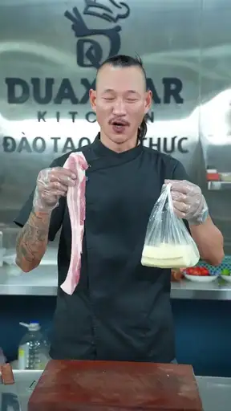

# Remotion Food Short VN

Skill dựng video món ăn dọc bằng Remotion theo phong cách editorial Việt Nam: title card gọn, phụ đề karaoke không nền, nhãn công đoạn rõ và popup được chọn từ ý nghĩa của SRT.

## Showcase: Original vs After

Hai preview động dưới đây cùng dài 10 giây. Bấm vào preview để mở MP4 có âm thanh.

<table>
  <tr>
    <th width="50%">Original</th>
    <th width="50%">After · New Skill</th>
  </tr>
  <tr>
    <td align="center">
       
      <a href="./video_output/original.mp4">▶ Mở Original có tiếng</a>
    </td>
    <td align="center">
       
      <a href="./video_output/after.mp4">▶ Mở After có tiếng</a>
    </td>
  </tr>
</table>

> GitHub loại bỏ thẻ HTML `<video>` trong README. Animated WebP được dùng làm preview tương thích; hai MP4 H.264/AAC trong `video_output/` giữ nguyên âm thanh.

## Thiết kế được áp dụng

- Intro 1,5–2,5 giây trên footage blur/dim; không chồng title, step label và subtitle.
- Subtitle nổi trực tiếp trên hình, từ đang đọc chuyển sang màu vàng, không có background.
- Nhãn bước canh trái với vạch màu làm neo thị giác.
- AI đọc SRT để chọn popup cho lợi ích, nguyên nhân, so sánh, lựa chọn và định lượng.
- Popup chỉ bổ sung cấu trúc; không chép lại nguyên câu subtitle.
- Video hướng dẫn dài dùng nhịp popup thưa khoảng 8–18 giây để tránh cảm giác template.

## Cấu trúc skill

- `SKILL.md`: quy trình và nguyên tắc chính.
- `references/style-system.md`: typography, subtitle, step label, intro và outro.
- `references/srt-insight-popups.md`: cách phân tích SRT và chọn loại popup.
- `video_output/original.mp4`: footage gốc 10 giây, có tiếng.
- `video_output/after.mp4`: footage sau khi áp dụng skill, 10 giây, có tiếng.
- `video_output/*.webp`: preview động dành cho GitHub README.
- `scripts/build-github-readme.ps1`: tạo lại README tương thích GitHub.

Khi upload GitHub, hãy commit toàn bộ thư mục skill, đặc biệt là `README.md` và `video_output/`.
