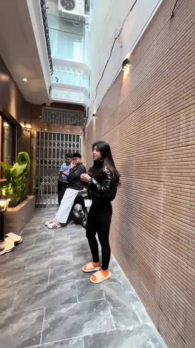
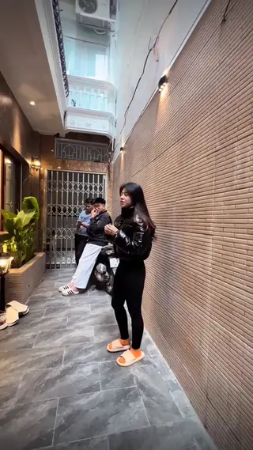

# Remotion House Review VN

Skill dựng video review nhà ở dọc bằng Remotion theo chuẩn Luxury Realtor: kỹ thuật Text-Behind-Reviewer (chữ 3D depth matting), B-Roll Photo Showcase thay thế cảnh đi bộ thô khi vào khúc phụ, bộ 3 phông chữ đẳng cấp (Serif + Script vàng + Modern Sans), phụ đề karaoke động không nền và hệ thống đồ họa 4 dạng chống template slop.

## Showcase: Original vs After

Hai video so sánh dưới đây cùng dài 10 giây (**đầy đủ track âm thanh giọng nói của reviewer**).  
*Nhấp vào ảnh preview hoặc đường dẫn bên dưới để mở phát trực tiếp video có âm thanh trên trình duyệt:*

<table>
  <tr>
    <th width="50%">Original (Footage Gốc)</th>
    <th width="50%">After · New Skill (Bản Edit Mới)</th>
  </tr>
  <tr>
    <td align="center">
      
        
      <a href="https://github.com/npdk1/SkillCut/raw/main/.codex/remotion-house-review-vn/video_output/original.mp4">
        🔊 <b>Bấm Xem / Tải Original (10s MP4)</b>
      </a>
    </td>
    <td align="center">
      
        
      <a href="https://github.com/npdk1/SkillCut/raw/main/.codex/remotion-house-review-vn/video_output/after.mp4">
        🔊 <b>Bấm Xem / Tải After (10s MP4)</b>
      </a>
    </td>
  </tr>
</table>

> 📦 **File video gốc đính kèm**: Cả 2 clip có sẵn trong thư mục [`video_output/`](./video_output/) và đính kèm tại [Releases v1.0.0](https://github.com/npdk1/SkillCut/releases/tag/v1.0.0).

---

## Thiết kế được áp dụng

- **Text Behind Reviewer (Depth Occlusion)**: Chữ 3D khổng lồ neo sâu trong không gian hành lang sau lưng reviewer; reviewer bước tới che khuất một phần chữ tạo cảm giác không gian chân thực.
- **B-Roll Photo Showcase Cutaways**: Nhận diện Khúc Phụ (mô tả tiện nghi, chém gió) để cắt sang ảnh/footage kiến trúc đẹp nhất (phòng ngủ master, gương sóng nghệ thuật, quầy bar, sân thượng sky garden) với Ken Burns zoom chậm, trong khi âm thanh thoại gốc vẫn phát liên tục bên dưới.
- **Subtitle Karaoke Động**: Chữ trắng viền đen nổi trực tiếp trên hình, từ đang nói phóng to nhẹ (kinetic pop 1.08x) và chuyển sang vàng hoàng kim `#FFD21C`, tuyệt đối không dùng panel xám hay hộp mờ che cảnh.
- **Bộ 3 Phông Chữ Đẳng Cấp (Font Triad)**: Phối hợp Luxury Serif (`Playfair Display`), Handwritten Cursive Script vàng chanh (`Dancing Script`) và Modern Sans (`Be Vietnam Pro`).
- **4 Hình Thức Đồ Họa Riêng Biệt**: Hook mở đầu 3D, Stat Rail (diện tích/số tầng), Hero Price (chữ số vàng kim 3D + camera punch zoom), Minimal Chip (full nội thất, xây mới).
- **Khoảng Thở & Nhịp Sóng Điện Ảnh**: Luân chuyển A-Roll $\leftrightarrow$ B-Roll nhịp nhàng, chừa khoảng nghỉ 3–6s để người xem ngắm nhà thật; loại bỏ toàn bộ popup cho câu cảm thán sáo rỗng.
- **Tự Động Bắt Lỗi Va Chạm**: Component `LayoutCollisionGuard` giám sát bounding box ở render time để loại bỏ hoàn toàn tình trạng đè chữ hoặc lấn phụ đề.

---

## Cấu trúc skill

- `SKILL.md`: quy trình, nguyên tắc phân tầng và hướng dẫn sử dụng chính.
- `references/style-system.md`: cấu trúc 7 tầng layer Remotion, Font Triad, công thức tạo alpha mask và tiêu chuẩn đồ họa.
- `references/scene-architecture.md`: phương pháp phân loại raw 9 phút thành Khúc Chính vs Khúc Phụ, nhịp sóng xen kẽ và mã nguồn showcase.
- `references/property-insights.md`: cách đọc SRT phân tích thông số và quy tắc anti-slop pruning.
- `references/quality-control.md`: kiểm tra FPS, độ phân giải, độ lệch A/V dưới 0,1s và tự kiểm tra layout.
- `references/feedback-learning.md`: bài học chuẩn hóa chống template slop và nâng cấp chuẩn Luxury Realtor.
- `assets/`: các component React/Remotion dùng chung (`BehindHostText.tsx`, `HostCutout.tsx`, `PhotoShowcase.tsx`, `LayoutCollisionGuard.tsx`, `font.ts`).
- `video_output/original.mp4`: footage gốc 10 giây, có tiếng AAC stereo.
- `video_output/after.mp4`: footage sau khi áp dụng skill, 10 giây, có tiếng AAC stereo.
- `video_output/original-preview.webp`: ảnh động WebP xem trước của video gốc.
- `video_output/after-preview.webp`: ảnh động WebP xem trước của video đã edit.
